<div align="center">


# Mozaik

**A self-hosted hub for your personal records, with a Material 3 Expressive Android app.**

Mozaik collects your meals, films, books, music, health data and phone notifications in one database that you own, and shows them in a single timeline.

[](https://github.com/Enki013/Mozaik/releases/latest)
[](https://kotlinlang.org/)
[](https://developer.android.com/jetpack/compose)
[](https://workers.cloudflare.com/)
[](https://go.dev/)
[](LICENSE)

**English** · [Türkçe](README.tr.md)

<p>
  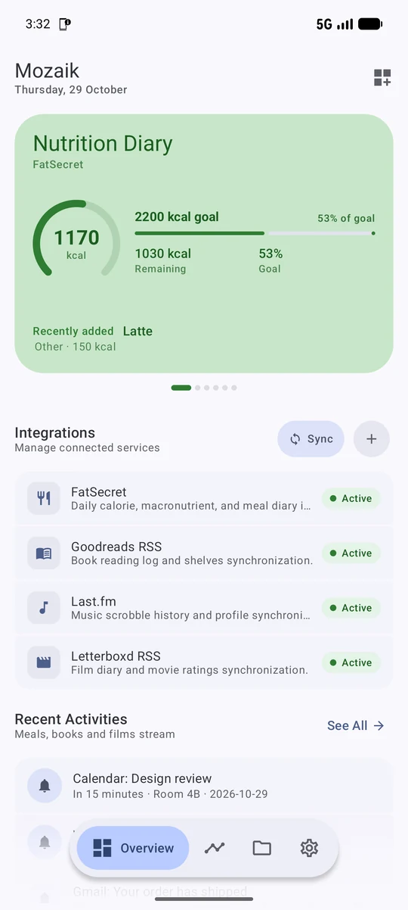
  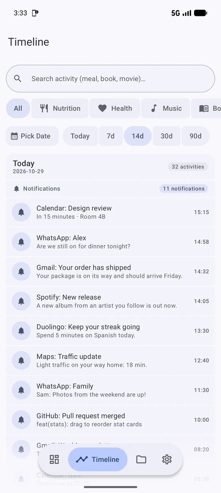
  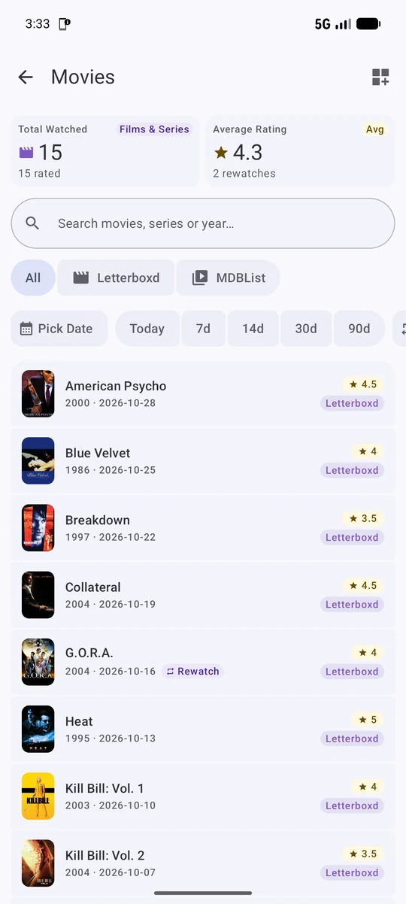
  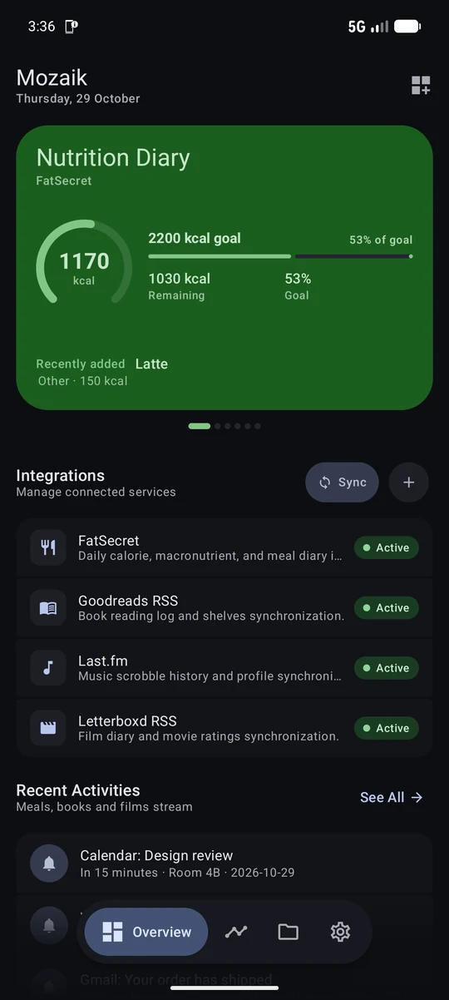
</p>

</div>

---

## Contents

- [How it works](#how-it-works)
- [Features](#features)
- [Screenshots](#screenshots)
- [Companion apps](#companion-apps)
- [Quick start](#quick-start)
- [Server setup](#server-setup)
- [Android app](#android-app)
- [Connecting integrations](#connecting-integrations)
- [Security](#security)
- [Backups and export](#backups-and-export)
- [Development and tests](#development-and-tests)
- [Project structure](#project-structure)
- [Documentation](#documentation)
- [Contributing](#contributing)
- [Acknowledgements](#acknowledgements)
- [License](#license)

---

## How it works

Mozaik has two parts:

1. **A server** that stores everything. Pick one of two engines; both expose the same REST API, apart from a few Worker-only features:
   - **Cloudflare Worker + D1** (recommended): serverless, free tier, runs 24/7, pulls new data every 6 hours with a cron trigger.
   - **Go + SQLite**: self-hosted on your own machine, a home server or a VPS, with Docker Compose. Music integrations are not available on this engine yet.
2. **The Mozaik Android app**, which reads from your server. It does not run heavy background services itself.

Data reaches the server in two ways:

- **Pull sync:** the server fetches Goodreads and Letterboxd RSS feeds, and the FatSecret, Last.fm, Trakt and other APIs.
- **Push webhooks:** small companion apps on your phone or browser send notifications, health data and scrobbles to the server.

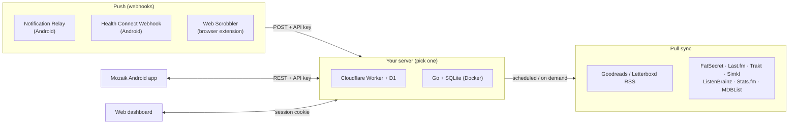

---

## Features

### Android app

- **Material 3 Expressive** design: expressive motion, shape morphing, connected button groups, loading indicators and a floating navigation bar.
- **Overview:** a swipeable carousel of stat cards (calories, books, films, music, health, notifications) and your connected integrations.
- **Timeline:** every record from every source in one feed, with search, a source filter and quick date ranges (Today, 7, 14, 30, 90 days).
- **Records:** a dedicated screen for each category: nutrition, books, films and series, music, health and notifications.
- **Consistent filters on every screen:** search, sort, a custom date picker, quick date ranges and a result count.
- **Customizable stats:** show or hide any stat card, and drag to reorder them. The order is saved per screen.
- **Integration catalog:** turn services on or off, see setup steps, and copy webhook URLs.
- **Adaptive layout:** list-detail panes and a navigation rail on tablets and foldables.
- **English and Turkish**, switchable inside the app, independent of the system language.
- **Dynamic color** (Material You) on Android 12+, and light and dark themes.
- **Data export:** download a full JSON archive or the raw SQLite database to your phone.

### Data sources

| Category | Sources | How |
| :--- | :--- | :--- |
| 🥗 Nutrition | [FatSecret](https://platform.fatsecret.com/) | API (bring your own key) |
| 📚 Books | [Goodreads](https://www.goodreads.com/) | RSS |
| 🎬 Films and series | [Letterboxd](https://letterboxd.com/), [Trakt.tv](https://trakt.tv/), [Simkl](https://simkl.com/), [MDBList](https://mdblist.com/) ratings | RSS / API |
| 🎵 Music | [Last.fm](https://www.last.fm/), [ListenBrainz](https://listenbrainz.org/), [Stats.fm](https://stats.fm/), [Web Scrobbler](https://web-scrobbler.com/) | API / webhook (Cloudflare Worker only) |
| ❤️ Health | Health Connect (Samsung Health, Google Fit, Fitbit and others) | Webhook, via [Health Connect Webhook](#companion-apps) |
| 🔔 Notifications | Android notifications | Webhook, via [Notification Relay](#companion-apps) |

Planned: Spotify Direct API, Steam, and music support on the Go engine. See the [roadmap](docs/ROADMAP.md).

### Server

- The same REST API on both engines, so the app works with either one. Music, integration toggles and the SQL dump are Worker-only for now (see the [parity table](docs/ARCHITECTURE.md#3-server-engine-parity)).
- A built-in **web dashboard** behind a password screen.
- **Authentication** on every data, export and sync route.
- A strict CORS allowlist, security headers and a sync cooldown that protects external services from too many requests.
- **Export** as SQL dump, SQLite file or JSON.

---

## Screenshots

<table>
  <tr>
    <td align="center"><br/><sub>Overview</sub></td>
    <td align="center"><br/><sub>Timeline</sub></td>
    <td align="center">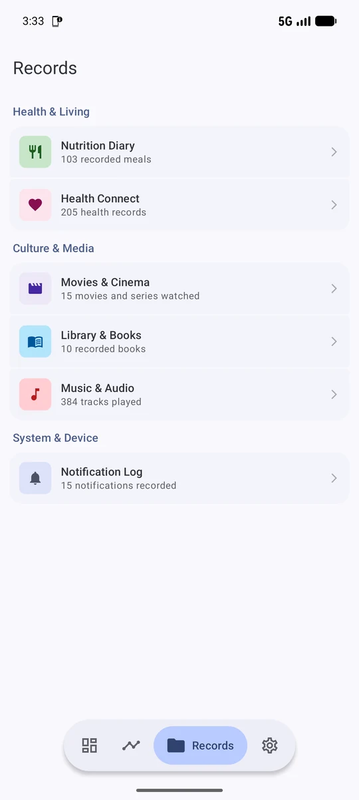<br/><sub>Records</sub></td>
    <td align="center">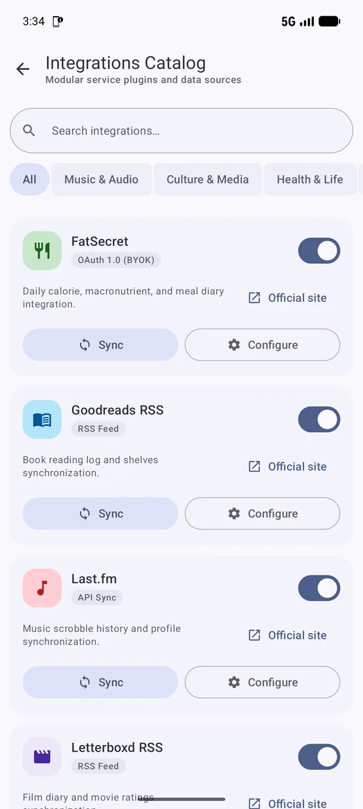<br/><sub>Integration catalog</sub></td>
  </tr>
  <tr>
    <td align="center">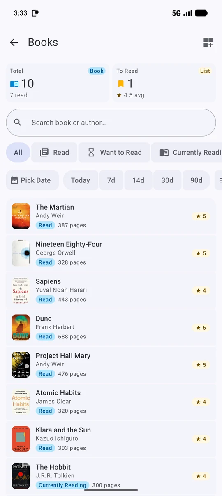<br/><sub>Books</sub></td>
    <td align="center"><br/><sub>Films</sub></td>
    <td align="center">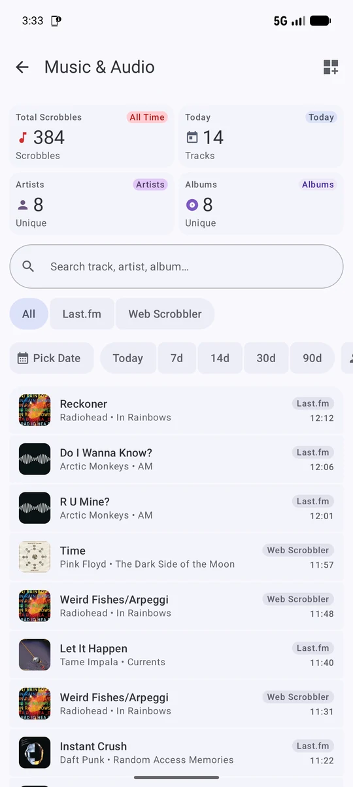<br/><sub>Music</sub></td>
    <td align="center">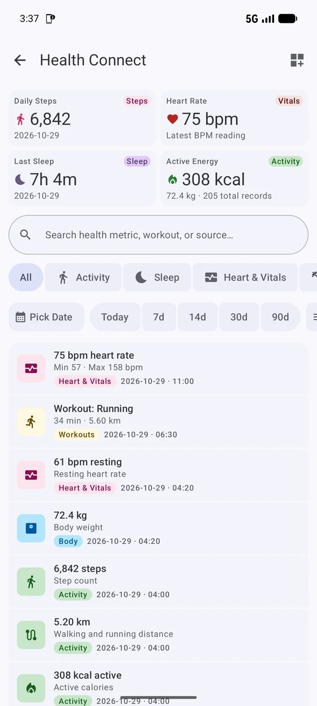<br/><sub>Health Connect</sub></td>
  </tr>
  <tr>
    <td align="center">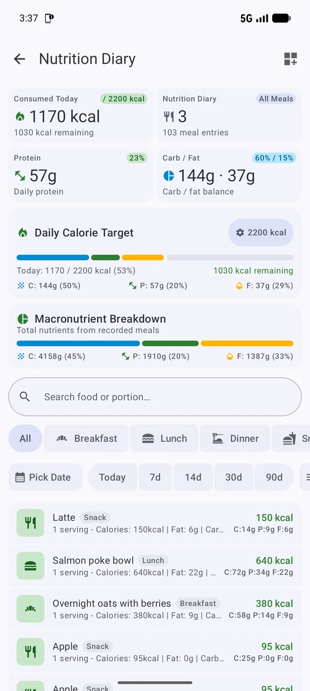<br/><sub>Nutrition</sub></td>
    <td align="center">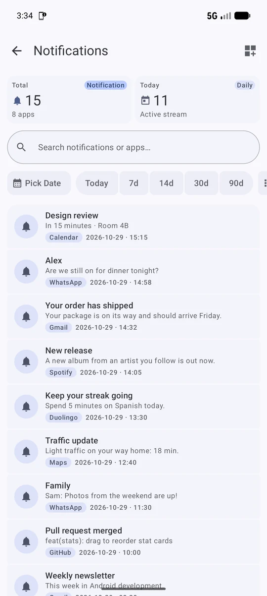<br/><sub>Notifications</sub></td>
    <td align="center"><br/><sub>Overview (dark)</sub></td>
    <td align="center">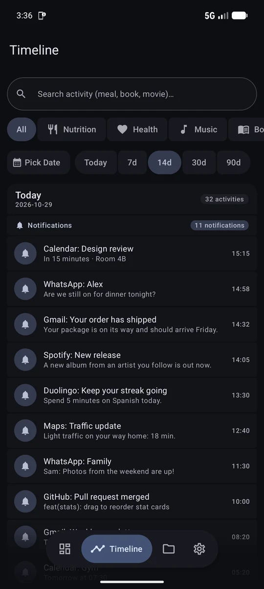<br/><sub>Timeline (dark)</sub></td>
  </tr>
  <tr>
    <td align="center">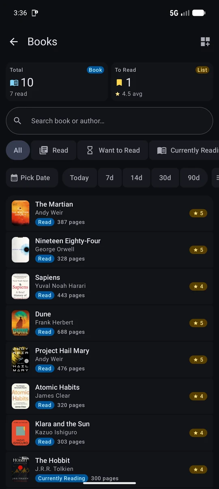<br/><sub>Books (dark)</sub></td>
    <td align="center">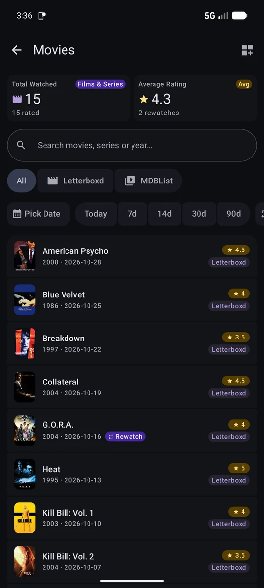<br/><sub>Films (dark)</sub></td>
  </tr>
</table>

Screenshots use fictional demo data.

---

## Companion apps

Mozaik does not read your notifications or health data itself. Two open-source Android apps send that data to your server.

| App | What it sends | Download |
| :--- | :--- | :--- |
| **[Notification Relay Webhook](https://github.com/Enki013/notification-relay-webhook)** | Your phone's notifications, to `/api/webhooks/notification` | [Releases](https://github.com/Enki013/notification-relay-webhook/releases) |
| **[Health Connect Webhook](https://github.com/mcnaveen/health-connect-webhook)** | Steps, sleep, heart rate, workouts, weight and more from Health Connect, to `/api/webhooks/health` | [Releases](https://github.com/mcnaveen/health-connect-webhook/releases) |

> [!NOTE]
> **Notification Relay:** use [my fork](https://github.com/Enki013/notification-relay-webhook). It adds a fix that keeps the background service connected on HyperOS (Xiaomi) and improves onboarding. It is based on [cobanov/notification-relay-webhook](https://github.com/cobanov/notification-relay-webhook).

Setup steps for both apps are in [Connecting integrations](#connecting-integrations).

---

## Quick start

1. **Deploy a server.** The quickest way is [Cloudflare Worker + D1](#option-1-cloudflare-worker--d1-recommended). It takes about 10 minutes and is free.
2. **Install the app.** Download the APK from the [latest release](https://github.com/Enki013/Mozaik/releases/latest).
3. **Connect.** In the app, open **Settings**, enter your server URL and API key, and tap **Test connection**.
4. **Add sources.** Enter your Goodreads ID, Letterboxd username or Last.fm username, and install the [companion apps](#companion-apps) if you want notifications and health data.

---

## Server setup

### Option 1: Cloudflare Worker + D1 (recommended)

Free on the Cloudflare free tier, always on, nothing to maintain.

**Requirements:** Node.js 18+ and a free [Cloudflare account](https://dash.cloudflare.com/sign-up).

```bash
cd worker
npm install
npx wrangler login

# Create the database
npx wrangler d1 create personal-records-db
```

Copy the `database_id` from the output into `worker/wrangler.toml` (start from `worker/wrangler.toml.example` if you prefer).

```bash
# Create the tables
npx wrangler d1 execute personal-records-db --remote --file=./schema.sql

# Set your API key (choose a long random value)
npx wrangler secret put API_KEY

# Optional: FatSecret and Last.fm credentials
npx wrangler secret put FATSECRET_CONSUMER_KEY
npx wrangler secret put FATSECRET_CONSUMER_SECRET
npx wrangler secret put LASTFM_API_KEY
npx wrangler secret put LASTFM_USERNAME

# Deploy
npx wrangler deploy
```

Your server URL is printed at the end, for example `https://personal-records-api.<your-subdomain>.workers.dev`.

> [!TIP]
> Generate a strong key with `openssl rand -hex 32`.

For local development, copy `worker/.dev.vars.example` to `worker/.dev.vars` and run `npm run dev`. More details are in [worker/README.md](worker/README.md).

### Option 2: Docker Compose

For a Raspberry Pi, NAS, home server or VPS.

```bash
# Docker Compose reads API_KEY from a .env file in the repository root
echo "API_KEY=$(openssl rand -hex 32)" > .env

docker compose up -d
```

- API and web dashboard: `http://localhost:8787`
- Data is stored in `./data/personal_records.sqlite3`
- Check health with `docker compose ps`
- Other settings (`APP_BASE_URL`, FatSecret keys, `ALLOWED_ORIGINS`) go in the same root `.env` file or in `docker-compose.yml`. The container does not read `backend/.env`.

A prebuilt image is published to the GitHub Container Registry by the `docker-publish` workflow.

### Option 3: Go backend without Docker

```bash
cd backend
cp .env.example .env
go run ./cmd/personal-records
```

See [backend/README.md](backend/README.md).

---

## Android app

**Requirements:** Android 8.0 (API 26) or newer.

### Install

Download `app-release.apk` from the [latest release](https://github.com/Enki013/Mozaik/releases/latest). Each release includes a `SHA256SUMS.txt` file to verify the download.

### Build from source

You need JDK 17 or newer. Android Studio's bundled JDK works.

```bash
cd android
./gradlew assembleDebug
```

The APK is written to `android/app/build/outputs/apk/debug/app-debug.apk`. On macOS, if Gradle cannot find Java, point it at Android Studio's JDK:

```bash
export JAVA_HOME="/Applications/Android Studio.app/Contents/jbr/Contents/Home"
```

### First run

1. Open **Settings** from the navigation bar.
2. **Server URL:**
   - Cloudflare: `https://personal-records-api.<your-subdomain>.workers.dev`
   - Local Go server: `http://<your-computer-ip>:8787` (from the Android emulator, use `http://10.0.2.2:8787`)
3. **API key:** the `API_KEY` you set on the server.
4. Tap **Test Connection**. A green badge confirms that the URL and key work.
5. Enter your source accounts (Goodreads ID, Letterboxd username, Last.fm username, daily calorie goal) and sync.

---

## Connecting integrations

Every webhook needs your API key. Send it in one of these ways:

- Header `X-API-Key: <API_KEY>`
- Header `Authorization: Bearer <API_KEY>`
- Header `X-Webhook-Secret: <API_KEY>`
- Query string `?api_key=<API_KEY>`, for apps that cannot set headers

The app's **Settings** and **Integration catalog** screens show each webhook URL and can copy it with the key already attached.

### Notifications: Notification Relay

1. Install [Notification Relay Webhook](https://github.com/Enki013/notification-relay-webhook/releases) and grant **Notification access**.
2. Add a webhook with the URL `https://<your-server>/api/webhooks/notification`.
3. Add the header `X-API-Key: <API_KEY>`, or append `?api_key=<API_KEY>` to the URL.
4. Send a test notification. It appears in Mozaik under **Records → Notifications**.

The payload looks like this:

```json
{
  "packageName": "com.whatsapp",
  "title": "Alex",
  "text": "Meeting at 3 pm.",
  "postTime": 1710000000000
}
```

### Health: Health Connect Webhook

1. Install [Health Connect Webhook](https://github.com/mcnaveen/health-connect-webhook/releases) and allow access to the data types you want to share.
2. Set the webhook URL to `https://<your-server>/api/webhooks/health`.
3. Add the header `X-Webhook-Secret: <API_KEY>`, or append `?api_key=<API_KEY>` to the URL.
4. Choose a sync interval and start the background sync. Data appears under **Records → Health Connect**.

Sending `GET` to the same URL returns the endpoint status, which is handy for checking the setup.

### Music: Web Scrobbler

1. Install the [Web Scrobbler](https://web-scrobbler.com/) extension for Chrome or Firefox.
2. In its settings, enable the **Webhook** service.
3. URL: `https://<your-server>/api/webhooks/music`, header `X-API-Key: <API_KEY>`.
4. Songs played on YouTube, SoundCloud, Bandcamp and other web players now appear in your timeline.

### Music: Last.fm, ListenBrainz, Stats.fm

Turn the service on in the **Integration catalog**, then enter your username in **Settings** and sync. ListenBrainz and Stats.fm only need a public username. For Stats.fm, make sure *Recently played* is public. For Last.fm you can add your own [API key](https://www.last.fm/api/account/create); it is optional when the server has `LASTFM_API_KEY` set.

### Nutrition: FatSecret

1. Get a free API key from the [FatSecret Platform](https://platform.fatsecret.com/api/).
2. Enter the consumer key and secret in **Settings → Nutrition integration (FatSecret)**, or set them as Worker secrets.
3. Link your profile and sync your meal history.

More details are in [docs/FATSECRET_SYNC_STRATEGY.md](docs/FATSECRET_SYNC_STRATEGY.md).

### Books and films: Goodreads, Letterboxd

- **Goodreads:** enter your numeric user ID or your profile URL (`https://goodreads.com/user/show/<id>`). Shelves (read, currently reading, want to read) sync from RSS.
- **Letterboxd:** enter your username or your RSS URL (`https://letterboxd.com/<username>/rss/`).

### Films and series: Trakt.tv, Simkl, MDBList

- **Trakt.tv:** enter your username (public profiles need no password). Optionally set your own Client ID. Films and episodes are synced.
- **Simkl:** create a Client ID and Access Token at [simkl.com/settings/developer](https://simkl.com/settings/developer/) and enter them in **Settings**. Films, series and anime are synced.
- **MDBList:** add a free API key from [mdblist.com/preferences](https://mdblist.com/preferences). Film details then show IMDb, Rotten Tomatoes, Metacritic and Letterboxd ratings, cached for 14 days.

---

## Security

Mozaik stores personal data, so every data route is protected.

- **Authentication** on `/api/*`, `/api/export/*` and sync triggers. Accepted methods: `Authorization: Bearer`, `X-API-Key`, HTTP Basic, and an `HttpOnly; Secure; SameSite=Lax` session cookie for the web dashboard.
- **CORS allowlist:** only `localhost`, `10.0.2.2` (Android emulator), `*.workers.dev` and origins listed in `ALLOWED_ORIGINS`.
- **Security headers** on every response: `X-Frame-Options`, `X-Content-Type-Options`, `Referrer-Policy`, `Permissions-Policy` and a Content Security Policy.
- **Sync cooldown:** a 90-second window per source prevents hammering external services. Repeated calls return `429 Too Many Requests`. Add `?force=true` to bypass it.

Keep your API key out of git. `.env`, `.dev.vars` and keystores are already ignored. To report a vulnerability, see [SECURITY.md](SECURITY.md).

---

## Backups and export

Your data is never locked in. Export it from the app (**Settings → Data export**) or with the API:

| Endpoint | Format |
| :--- | :--- |
| `GET /api/export/all` | Full JSON archive |
| `GET /api/export/sql` | SQLite-compatible SQL dump (`CREATE TABLE` + `INSERT`), Worker only |
| `GET /api/export/db` | Raw SQLite database file |

```bash
curl -H "X-API-Key: $API_KEY" \
  "https://<your-server>/api/export/sql" > "backup_$(date +%F).sql"
```

---

## Development and tests

```bash
# Android unit tests and compile check
cd android
./gradlew testDebugUnitTest compileDebugKotlin

# Go backend tests
cd backend
go test ./...

# End-to-end test against a running server (Worker or Go)
API_KEY=<your-key> BASE_URL=https://<your-server> ./scripts/test_live_api.sh
```

The live test checks health, authentication (wrong and right keys, session login and logout), every protected route, webhooks, CORS blocking, security headers and the sync cooldown.

### Releases

The `android-release` workflow runs lint and unit tests, builds the release APK and AAB, writes SHA-256 checksums, and publishes a GitHub release with a changelog generated from [Conventional Commits](https://www.conventionalcommits.org/). It runs on pushes to `main`, on tags, and on demand.

---

## Project structure

```text
Mozaik/
├── android/            Mozaik Android app (Kotlin, Jetpack Compose, Material 3 Expressive)
│   └── app/src/main/java/com/personalrecords/app/
│       ├── core/       theme, networking, integrations catalog, preferences
│       ├── data/       repository
│       └── ui/         screens and shared components
├── worker/             Cloudflare Worker engine (TypeScript, Hono, D1)
│   ├── src/            API routes and web dashboard
│   └── schema.sql      D1 schema
├── backend/            Go engine (SQLite), Dockerfile
├── docs/               architecture, setup guide, API contract, roadmap
├── scripts/            test_live_api.sh
└── docker-compose.yml
```

The Android package is still `com.personalrecords.app`, and the Worker and database keep their `personal-records` names, so existing installs and deployments keep working.

---

## Documentation

- [Architecture](docs/ARCHITECTURE.md): system design, data models, integration plugin contract
- [Setup guide](docs/SETUP_GUIDE.md): step-by-step setup (Turkish)
- [Mobile API](docs/MOBILE_API.md): endpoints, JSON models and status codes
- [Roadmap](docs/ROADMAP.md): done and planned work

---

## Contributing

Issues and pull requests are welcome. Please read [CONTRIBUTING.md](CONTRIBUTING.md) first.

---

## Acknowledgements

- [cobanov/notification-relay-webhook](https://github.com/cobanov/notification-relay-webhook), the original Notification Relay app that my fork builds on
- [mcnaveen/health-connect-webhook](https://github.com/mcnaveen/health-connect-webhook), which sends Health Connect data to Mozaik
- [Web Scrobbler](https://web-scrobbler.com/), the browser scrobbling extension
- [Hono](https://hono.dev/), [Cloudflare D1](https://developers.cloudflare.com/d1/), [Jetpack Compose](https://developer.android.com/jetpack/compose) and [Material 3](https://m3.material.io/)

Mozaik is not affiliated with Goodreads, Letterboxd, FatSecret, Last.fm, Trakt, MDBList, Google or Samsung. All trademarks belong to their owners.

---

## License

Mozaik is released under the [MIT License](LICENSE).

The companion apps are separate projects with their own licenses (both GNU AGPL v3.0). Mozaik only links to them and talks to them over HTTP. It does not include their code.
