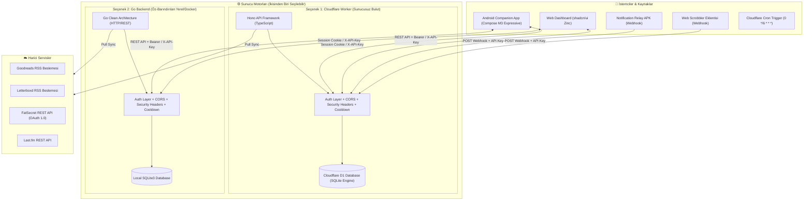

# 🏆 Kişisel Kayıtlar (Personal Records)

Kişisel beslenme (**FatSecret**), film günlüğü (**Letterboxd**), kitap okuma (**Goodreads**), müzik scrobble geçmişi (**Last.fm & Web Scrobbler**), sağlık/fitness verileri (**Health Connect / Samsung Health**) ve Android bildirimlerinizi tek bir merkezi havuzda toplayan, veri egemenliğinizi koruyan açık kaynaklı, çift motorlu (**Cloudflare Worker** / **Go**) kişisel takip platformu ve modern Android istemcisi.

[](https://kotlinlang.org/)
[](https://developer.android.com/jetpack/compose)
[](https://go.dev/)
[](https://workers.cloudflare.com/)
[](https://www.docker.com/)
[](LICENSE)

---

## 📑 İçindekiler

- [Öne Çıkan Özellikler](#-öne-çıkan-özellikler)
- [Mimari Genel Bakış](#-mimari-genel-bakış)
- [Dizin Yapısı (Monorepo)](#-dizin-yapısı-monorepo)
- [Kurulum Seçenekleri](#-kurulum-seçenekleri)
  - [Seçenek 1: Cloudflare Worker + D1 (Önerilen - Ücretsiz & 7/24 Bulut)](#seçenek-1-cloudflare-worker--d1-önerilen---ücretsiz--724-bulut)
  - [Seçenek 2: Docker Compose (Yerel / VPS Konteyner Kurulumu)](#seçenek-2-docker-compose-yerel--vps-konteyner-kurulumu)
  - [Seçenek 3: Yerel Go Backend ile Geliştirme](#seçenek-3-yerel-go-backend-ile-geliştirme)
- [Android İstemci Kurulumu & Yapılandırması](#-android-istemci-kurulumu--yapılandırması)
- [Entegrasyonlar ve Webhook Ayarları](#-entegrasyonlar-ve-webhook-ayarları)
- [Güvenlik, Kimlik Doğrulama & Sıkılaştırma](#-güvenlik-kimlik-doğrulama--sıkılaştırma)
- [Veri Egemenliği & Yedekleme (Export)](#-veri-egemenliği--yedekleme-export)
- [Test ve Doğrulama](#-test-ve-doğrulama)
- [Detaylı Belgeler (Docs)](#-detaylı-belgeler-docs)

---

## ✨ Öne Çıkan Özellikler

### 1. 🥗 Beslenme & Makro Takibi (FatSecret)
- Günlük toplam kalori, protein, karbonhidrat ve yağ makroları.
- Öğün bazlı (Kahvaltı, Öğle, Akşam, Ara Öğün) besin dökümü.
- Dinamik kalori hedefi belirleme ve anlık güncelleme.
- BYOK (Kendi API Anahtarını Getir) modeli ile OAuth 1.0/2.0 entegrasyonu.

### 2. 🎬 Sinema, Dizi & Medya (Letterboxd, Trakt.tv & MDBList)
- **Letterboxd RSS**: Film izleme günlüğü, afişler, izleme tarihleri, puanlama ve yeniden izleme (*rewatch*) durumu.
- **Trakt.tv API v2**: Hem filmler hem de televizyon dizileri (sezon ve bölüm bazlı `S01E05 · Title` scrobble geçmişi), izleme tarihleri ve puanlar.
- **MDBList Çoklu Platform Puan Agregatörü**: IMDb (⭐), Rotten Tomatoes (🍅 / 🍿), Metascore (Ⓜ️), Letterboxd (🟢) ve Trakt (📺) puanlarının tek birleşik kartta toplanması. 14 günlük akıllı önbellekleme ile API kota koruması.

### 3. 📚 Kitap & Okuma Alışkanlığı (Goodreads)
- Goodreads kullanıcı ID ile RSS üzerinden otomatik kitaplık senkronizasyonu.
- Raflara göre sınıflandırma (*Okunanlar*, *Şu Anda Okunanlar*, *Okunacaklar*).
- Kitap kapakları, yazar bilgileri, sayfa sayıları ve verilen puanlar.

### 4. 🎵 Müzik & Scrobble Geçmişi (Last.fm, Web Scrobbler, ListenBrainz, Stats.fm)
- **Web Scrobbler Webhook**: Tarayıcıda (YouTube, Spotify Web, SoundCloud vb.) dinlenen parçaları anında `/api/webhooks/music` ile kaydetme.
- **Last.fm & ListenBrainz Sync**: Otomatik veya tetiklemeli geçmiş senkronizasyonu.
- **Stats.fm (Spotistats)**: Spotify akışları ve dinleme analitikleri senkronizasyonu.
- Albüm kapakları, sanatçı istatistikleri ve en çok dinlenen parçalar.

### 5. 🏃 Sağlık & Fitness (Health Connect / Samsung Health / Google Fit)
- Adım sayısı, aktif kalori, mesafe, egzersiz/antrenman, uyku analizi, nabız ve ağırlık takibi.
- Android Health Connect verilerini periyodik olarak sunucuya aktaran `/api/webhooks/health` desteği.

### 6. 🔔 Akıllı Bildirim Arşivi (Notification Relay)
- Android bildirim dinleyicisi ile gelen bildirimleri `/api/webhooks/notification` üzerinden filtreleyip arşivleme.
- Paket adı, başlık, metin ve zaman bilgisine göre anlık arama ve bildirim zaman tüneli.

### 7. 📱 Modern Android İstemcisi
- **Jetpack Compose + Material 3 Expressive**: Bento Grid yerleşimi, akıcı yay (*spring*) animasyonları, şekil dönüşümleri (*shape morphing*).
- **Çift Motor Uyumlu**: Hem yerel Go sunucusuna (`http://192.168.x.x:8787`) hem de Cloudflare Worker bulutuna sorunsuz bağlanabilme.
- **Güvenli Kimlik Yönetimi**: Ayarlar ekranından API anahtarı tanımlama, gizleme/gösterme ve anlık sunucu bağlantı testi.

### 8. 🌐 Modern Web Gösterge Paneli
- Cloudflare Worker ve Go backend üzerinde gömülü olarak sunulan **shadcn/ui Zinc** temalı web paneli.
- Şifreli kilit ekranı, `HttpOnly` oturum yönetimi, karanlık/aydınlık tema ve tam veri yönetimi.

### 9. 🔌 Genişletilebilir Eklenti Kataloğu & Yol Haritası
Android istemcisinde yer alan Entegrasyon Kataloğu üzerinden tek tıkla açılıp kapatılabilen modüler servis mimarisi:
- **Mevcut / Aktif Eklentiler**: Web Scrobbler (Tarayıcı), Last.fm, Goodreads RSS, Letterboxd RSS, FatSecret BYOK, Health Connect Webhook, Notification Relay, ListenBrainz, Stats.fm, **Trakt.tv** (Sinema & Dizi Scrobbler), **MDBList** (Çoklu Platform Puan Agregatörü).
- **Planlanan / Geliştirme Aşamasındaki Eklentiler**:
  - 🎧 **Spotify Direct API**: Doğrudan Spotify Connect ve anlık çalan şarkı senkronizasyonu.
  - 🎮 **Steam**: Oyun kütüphanesi, oynama süreleri ve başarım (*achievement*) geçmişi.

---

## 🏛️ Mimari Genel Bakış

Proje, bağımsız iki sunucu motoru (Cloudflare Worker veya Go) ve modern bir Android istemcisinden oluşan **hibrit bir monorepo** olarak tasarlanmıştır:



---

## 📂 Dizin Yapısı (Monorepo)

```text
personal-records/
├── android/                  # Android İstemcisi (Kotlin 2.x, Jetpack Compose, M3 Expressive)
│   ├── app/src/main/java/    # Clean Architecture: UI, ViewModel, Repository, Network
│   └── app/build.gradle.kts  # Gradle yapılandırması
├── backend/                  # Öz-Barındırılan Go Sunucusu
│   ├── cmd/personal-records/ # Go ana giriş noktası (main.go)
│   ├── internal/             # Application, Domain, Infrastructure (SQLite), Presentation
│   ├── Dockerfile            # Multi-stage Go konteyner imajı
│   └── .env.example          # Ortam değişkeni şablonu
├── worker/                   # Sunucusuz Cloudflare Motoru
│   ├── src/                  # Hono TypeScript yönlendiricileri ve HTML paneli
│   ├── schema.sql            # Cloudflare D1 veritabanı şeması
│   └── wrangler.toml         # Cloudflare Worker & D1 yapılandırması
├── scripts/                  # Otomasyon ve test betikleri
│   └── test_live_api.sh      # 49/49 kapsamlı canlı API test aracı
├── docs/                     # Ayrıntılı mimari, kurulum ve API belgeleri
│   ├── ARCHITECTURE.md       # Sistem ve eklenti mimarisi
│   ├── SETUP_GUIDE.md        # Adım adım kurulum kılavuzu
│   ├── MOBILE_API.md         # API sözleşmesi ve uç noktalar
│   └── ROADMAP.md            # Geliştirme yol haritası
└── docker-compose.yml        # Tek komutla Go + SQLite ayağa kaldırma
```

---

## 🚀 Kurulum Seçenekleri

Aşağıdaki üç sunucu seçeneğinden ihtiyacınıza en uygun olanı seçebilirsiniz:

### Seçenek 1: Cloudflare Worker + D1 (Önerilen - Ücretsiz & 7/24 Bulut)

Cloudflare Workers ve D1 Serverless SQLite sayesinde sunucu yönetimi veya maliyet olmadan 7/24 kesintisiz çalışır.

#### 1. Gereksinimler
- Node.js 18+ ve npm
- Ücretsiz [Cloudflare Hesabı](https://dash.cloudflare.com/)

#### 2. Kurulum ve Dağıtım Adımları
```bash
# 1. Worker dizinine geçin ve paketleri yükleyin
cd worker
npm install

# 2. Cloudflare hesabınıza giriş yapın
npx wrangler login

# 3. D1 veritabanınızı oluşturun
npx wrangler d1 create personal-records-db
```
> [!NOTE]
> `npx wrangler d1 create` komutunun çıktısındaki `database_id` değerini `worker/wrangler.toml` dosyasındaki `database_id` alanına yapıştırın.

```bash
# 4. Veritabanı tablolarını ve indeksleri oluşturun
npx wrangler d1 execute personal-records-db --remote --file=./schema.sql

# 5. Sunucu API Anahtarınızı güvenli secret olarak tanımlayın (Örn: YOUR_API_KEY)
npx wrangler secret put API_KEY

# (İsteğe Bağlı) FatSecret ve Last.fm anahtarları
npx wrangler secret put FATSECRET_CONSUMER_KEY
npx wrangler secret put FATSECRET_CONSUMER_SECRET
npx wrangler secret put LASTFM_API_KEY
npx wrangler secret put LASTFM_USERNAME

# 6. Worker'ı canlıya dağıtın (Deploy)
npx wrangler deploy
```

Deploy tamamlandığında terminalde beliren URL'nizi not edin:
`https://personal-records-api.<kullanici-adiniz>.workers.dev`

---

### Seçenek 2: Docker Compose (Yerel / VPS Konteyner Kurulumu)

Ev sunucunuzda (Raspberry Pi, NAS, Unraid, VPS) çalıştırmak için tek komut yeterlidir:

```bash
# 1. Ortam dosyasını oluşturun ve API Anahtarınızı belirleyin
cd backend
cp .env.example .env
nano .env   # API_KEY=guclu_bir_sifre belirleyin
cd ..

# 2. Konteyneri başlatın
docker compose up -d
```

- **Web / API Adresi:** `http://localhost:8787`
- **Kalıcı Veri Deposu:** `./data/personal_records.sqlite3`
- **Sağlık Denetimi:** `docker compose ps` ile sağlık durumunu izleyebilirsiniz.

---

### Seçenek 3: Yerel Go Backend ile Geliştirme

```bash
# 1. Go backend dizinine geçin
cd backend

# 2. .env dosyasını hazırlayın
cp .env.example .env

# 3. Bağımlılıkları kontrol edin ve çalıştırın
go mod tidy
go run ./cmd/personal-records
```

Birim ve entegrasyon testlerini çalıştırmak için:
```bash
go test -v ./...
```

---

## 📱 Android İstemci Kurulumu & Yapılandırması

Android uygulaması, telefonunuzun kaynaklarını tüketmeden sunucudaki tüm verilerinizi **Material 3 Expressive** arayüzüyle sunar.

### 1. APK'yı Derleme
Android Studio kullanarak projeyi açabilir veya terminalden doğrudan derleyebilirsiniz:

```bash
cd android
# Android Studio JDK yolunu kullanarak derleyin:
export JAVA_HOME="/Applications/Android Studio.app/Contents/jbr/Contents/Home"  # macOS
./gradlew assembleDebug
```
Üretilen APK dosyası: `android/app/build/outputs/apk/debug/app-debug.apk`

### 2. Uygulama İçi Yapılandırma
1. Uygulamayı açın ve sağ üstteki veya alt bardaki **Ayarlar** sekmesine gidin.
2. **Sunucu Adresi (Base URL):**
   - Cloudflare Worker kullanıyorsanız: `https://personal-records-api.xxxx.workers.dev`
   - Yerel Go backend kullanıyorsanız: `http://192.168.1.50:8787` (Bilgisayarınızın yerel IP'si)
3. **Sunucu API Anahtarı:** Sunucunuza tanımladığınız şifreyi (örneğin `YOUR_API_KEY`) girin.
4. **Bağlantıyı Test Et:** Butona bastığınızda uygulama sunucuya bağlanır ve API anahtarınızın geçerliliğini anlık olarak doğrular (`✅ Bağlantı ve API Anahtarı Doğrulandı`).
5. Ayarlar ekranından **Letterboxd Kullanıcı Adı**, **Goodreads Kullanıcı ID** ve **Günlük Kalori Hedefi** değerlerinizi kaydedin.

---

## 🔌 Entegrasyonlar ve Webhook Ayarları

### 1. Android Bildirimleri (Notification Relay APK)
Telefonunuza gelen bildirimleri otomatik olarak arşivlemek için:
- Açık kaynaklı [Notification Relay APK](https://github.com/Enki013/personal-records) veya muadili (MacroDroid, Tasker) kullanın.
- **Webhook URL:** `https://your-worker.workers.dev/api/webhooks/notification`
- **HTTP Header:** `X-API-Key: YOUR_API_KEY`
- **Payload Formatı:**
  ```json
  {
    "packageName": "com.whatsapp",
    "title": "Ahmet",
    "text": "Toplantı saat 15:00'te.",
    "postTime": 1710000000000
  }
  ```

### 2. Müzik Dinleme (Web Scrobbler Tarayıcı Eklentisi)
Chrome veya Firefox'ta [Web Scrobbler](https://web-scrobbler.com/) eklentisini kurun:
- Eklenti ayarlarından **Webhook** servisini aktif edin.
- **Webhook URL:** `https://your-worker.workers.dev/api/webhooks/music`
- **Secret / Header:** `X-API-Key: YOUR_API_KEY`
- Artık YouTube, Soundcloud, Bandcamp veya web tabanlı oynatıcılarda çalan şarkılar anında zaman tünelinize scrobble edilir.

### 3. FatSecret Beslenme Günlüğü
1. [FatSecret Platform](https://platform.fatsecret.com/api/) üzerinden ücretsiz bir API anahtarı alın.
2. Ayarlar ekranından Consumer Key ve Consumer Secret bilgilerinizi girin.
3. OAuth 1.0 akışı ile profilinizi eşleştirerek geçmiş öğünlerinizi tek tıkla çekin.

### 4. Trakt.tv Sinema ve Dizi Scrobbler
1. Ayarlar > Trakt bölümüne Trakt.tv kullanıcı adınızı girin (herkese açık profiller için şifre gerekmez).
2. İsteğe bağlı olarak kendi Trakt API Client ID bilginizi kaydedin (boş bırakılırsa varsayılan genel istemci kullanılır).
3. "Filmleri Eşitle" ve "Dizi Bölümlerini Eşitle" seçeneklerini işaretleyip "Trakt'ı Eşitle" butonuna basın.

### 5. MDBList Çoklu Platform Puan Agregatörü
1. [mdblist.com/preferences](https://mdblist.com/preferences) adresinden ücretsiz API anahtarınızı alın.
2. Ayarlar > MDBList alanına API anahtarınızı kaydedin.
3. Letterboxd ve Trakt filmlerinizin detay sayfasında IMDb, Rotten Tomatoes, Metacritic ve Letterboxd puan rozetleri otomatik olarak belirecektir (14 gün önbelleklenir).

---

## 🛡️ Güvenlik, Kimlik Doğrulama & Sıkılaştırma

Platform, kişisel verilerinizi korumak için çok katmanlı savunma mimarisiyle donatılmıştır:

### 1. Çok Katmanlı Yetkilendirme
Tüm veri uç noktaları (`/api/*`), dışa aktarma rotaları (`/api/export/*`) ve senkronizasyon tetikleyicileri koruma altındadır. İstemciler aşağıdaki yöntemlerden herhangi biriyle kimlik doğrulayabilir:
- `Authorization: Bearer <API_KEY>`
- `X-API-Key: <API_KEY>`
- `Authorization: Basic <base64>`
- Web Paneli için `HttpOnly; Secure; SameSite=Lax` oturum çerezi (`pr_auth`)

### 2. Sıkı CORS Politikası
Eski joker (`*`) izinleri yerine katı beyaz liste uygulanır:
- Yalnızca `localhost`, `10.0.2.2` (Android emülatörü), `*.workers.dev` ve `ALLOWED_ORIGINS` içinde tanımlanan kökenlere izin verilir.
- Bilinmeyen/yabancı sitelerden (`evil.com` vb.) gelen isteklerde `Access-Control-Allow-Origin` başlığı verilmez ve tarayıcı düzeyinde engellenir.

### 3. HTTP Güvenlik Başlıkları
Tüm yanıtlarda otomatik olarak enjekte edilen güvenlik başlıkları:
```http
X-Frame-Options: DENY
X-Content-Type-Options: nosniff
X-XSS-Protection: 1; mode=block
Referrer-Policy: strict-origin-when-cross-origin
Permissions-Policy: camera=(), microphone=(), geolocation=(), payment=()
Content-Security-Policy: default-src 'self' ...
```

### 4. Senkronizasyon Cooldown & Hız Kısıtlama (Rate Limiting)
- Dış kaynakları (Goodreads, Letterboxd, FatSecret, Last.fm) aşırı sorgulamaktan ve IP ban riskinden korumak için **90 saniyelik bekleme penceresi** uygulanır.
- Peş peşe çağrılarda sistem `HTTP 429 Too Many Requests` ve kalan saniye bilgisini döndürür.
- Acil durumlar için `?force=true` parametresi ile bekleme aşılabilir.

---

## 💾 Veri Egemenliği & Yedekleme (Export)

Verileriniz hiçbir tescilli kapalı formatta hapsedilmez; dilediğiniz an tek tıkla dışa aktarabilirsiniz:

- **Ham SQL Dökümü:** `GET /api/export/sql`
  *(Tüm tabloların `CREATE TABLE` ve `INSERT` komutlarını içeren tam SQLite uyumlu SQL dökümü)*
- **Ham SQLite (.db) Dosyası:** `GET /api/export/db`
- **Eksiksiz JSON Arşivi:** `GET /api/export/all`

Örnek curl ile yedek alma:
```bash
curl -H "X-API-Key: YOUR_API_KEY" \
  https://personal-records-api.xxxx.workers.dev/api/export/sql > backup_$(date +%F).sql
```

---

## 🧪 Test ve Doğrulama

Sistemdeki tüm API uç noktaları, güvenlik mekanizmaları ve istemci modelleri otomatik testlerle korunmaktadır:

### 1. Kapsamlı Canlı API Test Süiti (49/49)
Canlı Cloudflare Worker veya yerel backend üzerindeki tüm uç noktaları test eden hazır bash aracı:

```bash
chmod +x scripts/test_live_api.sh
./scripts/test_live_api.sh
```
> **Test Kapsamı:** Sağlık denetimi, yanlış/doğru API anahtarı, oturum çerezi ile giriş/çıkış, tüm korumalı veri rotaları (401 & 200 durumları), webhook doğrulama, CORS engelleme, güvenlik başlıkları, 429 senkronizasyon cooldown ve `?force=true` bypass.

### 2. Go Backend Birim & Entegrasyon Testleri
```bash
cd backend
go test -v ./...
```

### 3. Android Birim & Derleme Testleri
```bash
cd android
./gradlew testDebugUnitTest
./gradlew compileDebugKotlin
```

---

## 📖 Detaylı Belgeler (Docs)

Daha fazla teknik ayrıntı ve kılavuz için belgeler klasörüne göz atabilirsiniz:

- 🏛️ **[Mimari Belgesi (docs/ARCHITECTURE.md)](docs/ARCHITECTURE.md)**: Temiz mimari, veri modelleri ve eklenti sözleşmesi.
- 📖 **[Kurulum Kılavuzu (docs/SETUP_GUIDE.md)](docs/SETUP_GUIDE.md)**: Sıfırdan adım adım resimli ve açıklamalı kurulum.
- 📱 **[Mobil REST API Sözleşmesi (docs/MOBILE_API.md)](docs/MOBILE_API.md)**: JSON modelleri, HTTP yanıt kodları ve uç nokta listesi.
- 🗺️ **[Yol Haritası (docs/ROADMAP.md)](docs/ROADMAP.md)**: Tamamlanan ve gelecekte planlanan özellikler.

---

## 📄 Lisans

Bu proje [MIT Lisansı](LICENSE) kapsamında açık kaynak olarak geliştirilmektedir. Kendi kişisel sunucunuzda özgürce barındırabilir, değiştirebilir ve geliştirebilirsiniz.
