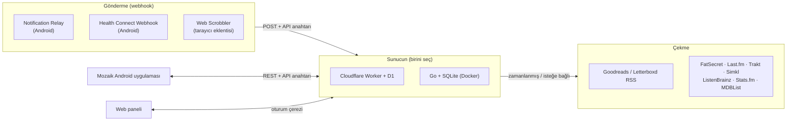

<div align="center">


# Mozaik

**Kişisel kayıtların için kendi sunucunda çalışan bir veri merkezi ve Material 3 Expressive tasarımlı Android uygulaması.**

Mozaik; öğünlerini, filmlerini, kitaplarını, müziklerini, sağlık verilerini ve telefon bildirimlerini sana ait tek bir veritabanında toplar ve hepsini tek bir zaman çizelgesinde gösterir.

[](https://github.com/Enki013/Mozaik/releases/latest)
[](https://kotlinlang.org/)
[](https://developer.android.com/jetpack/compose)
[](https://workers.cloudflare.com/)
[](https://go.dev/)
[](LICENSE)

[English](README.md) · **Türkçe**

<p>
  
  
  
  
</p>

</div>

---

## İçindekiler

- [Nasıl çalışır](#nasıl-çalışır)
- [Özellikler](#özellikler)
- [Ekran görüntüleri](#ekran-görüntüleri)
- [Yardımcı uygulamalar](#yardımcı-uygulamalar)
- [Hızlı başlangıç](#hızlı-başlangıç)
- [Sunucu kurulumu](#sunucu-kurulumu)
- [Android uygulaması](#android-uygulaması)
- [Entegrasyonları bağlama](#entegrasyonları-bağlama)
- [Güvenlik](#güvenlik)
- [Yedekleme ve dışa aktarma](#yedekleme-ve-dışa-aktarma)
- [Geliştirme ve testler](#geliştirme-ve-testler)
- [Proje yapısı](#proje-yapısı)
- [Belgeler](#belgeler)
- [Katkıda bulunma](#katkıda-bulunma)
- [Teşekkürler](#teşekkürler)
- [Lisans](#lisans)

---

## Nasıl çalışır

Mozaik iki parçadan oluşur:

1. Her şeyi saklayan bir **sunucu**. İki seçenekten birini kullanırsın. Yalnızca Worker'da olan birkaç özellik dışında ikisi de aynı REST API'yi sunar:
   - **Cloudflare Worker + D1** (önerilen): sunucusuz, ücretsiz katmanda çalışır, 7/24 açıktır ve cron tetikleyicisiyle 6 saatte bir yeni verileri çeker.
   - **Go + SQLite**: kendi bilgisayarında, ev sunucunda ya da VPS'te Docker Compose ile çalışır. Müzik entegrasyonları bu motorda henüz yok.
2. Verileri sunucundan okuyan **Mozaik Android uygulaması**. Uygulamanın kendisi ağır arka plan servisleri çalıştırmaz.

Veriler sunucuya iki yolla gelir:

- **Çekme (pull):** sunucu Goodreads ve Letterboxd RSS beslemelerini, FatSecret, Last.fm, Trakt ve diğer API'leri kendisi sorgular.
- **Gönderme (webhook):** telefonundaki ya da tarayıcındaki küçük yardımcı uygulamalar bildirimleri, sağlık verilerini ve dinlenen şarkıları sunucuya gönderir.



---

## Özellikler

### Android uygulaması

- **Material 3 Expressive** tasarım: canlı geçiş animasyonları, şekil dönüşümleri, bağlı buton grupları, yükleme göstergeleri ve yüzen gezinme çubuğu.
- **Özet:** kaydırılabilir istatistik kartları (kalori, kitap, film, müzik, sağlık, bildirim) ve bağlı entegrasyonların listesi.
- **Zaman Çizelgesi:** tüm kaynaklardaki kayıtlar tek akışta. Arama, kaynak filtresi ve hızlı tarih aralıkları (Bugün, 7, 14, 30, 90 gün) içerir.
- **Kayıtlar:** her kategori için ayrı ekran: beslenme, kitaplar, filmler ve diziler, müzik, sağlık ve bildirimler.
- **Her ekranda aynı filtreler:** arama, sıralama, özel tarih seçici, hızlı tarih aralıkları ve sonuç sayısı.
- **Özelleştirilebilir istatistikler:** istediğin kartı gizleyip gösterebilir, sürükleyerek sırasını değiştirebilirsin. Sıralama her ekran için ayrı kaydedilir.
- **Entegrasyon Kataloğu:** servisleri açıp kapatma, kurulum adımlarını görme ve webhook adreslerini kopyalama.
- **Uyarlanabilir yerleşim:** tablet ve katlanabilir cihazlarda liste-detay paneli ve yan gezinme çubuğu.
- **Türkçe ve İngilizce:** dil, sistem dilinden bağımsız olarak uygulama içinden değiştirilebilir.
- **Dinamik renk** (Material You, Android 12+), açık ve koyu tema.
- **Veri dışa aktarma:** tam JSON arşivini ya da ham SQLite veritabanını telefona indirme.

### Veri kaynakları

| Kategori | Kaynaklar | Yöntem |
| :--- | :--- | :--- |
| 🥗 Beslenme | [FatSecret](https://platform.fatsecret.com/) | API (kendi anahtarınla) |
| 📚 Kitaplar | [Goodreads](https://www.goodreads.com/) | RSS |
| 🎬 Film ve dizi | [Letterboxd](https://letterboxd.com/), [Trakt.tv](https://trakt.tv/), [Simkl](https://simkl.com/), [MDBList](https://mdblist.com/) puanları | RSS / API |
| 🎵 Müzik | [Last.fm](https://www.last.fm/), [ListenBrainz](https://listenbrainz.org/), [Stats.fm](https://stats.fm/), [Web Scrobbler](https://web-scrobbler.com/) | API / webhook (yalnızca Cloudflare Worker) |
| ❤️ Sağlık | Health Connect (Samsung Health, Google Fit, Fitbit ve diğerleri) | Webhook, [Health Connect Webhook](#yardımcı-uygulamalar) ile |
| 🔔 Bildirimler | Android bildirimleri | Webhook, [Notification Relay](#yardımcı-uygulamalar) ile |

Planlananlar: Spotify Direct API, Steam ve Go motorunda müzik desteği. Ayrıntılar [yol haritasında](docs/ROADMAP.md).

### Sunucu

- İki motorda da aynı REST API, böylece uygulama ikisiyle de çalışır. Müzik, entegrasyon anahtarları ve SQL dökümü şimdilik yalnızca Worker'da var (bkz. [karşılaştırma tablosu](docs/ARCHITECTURE.md#3-server-engine-parity)).
- Şifre ekranıyla korunan dahili **web paneli**.
- Tüm veri, dışa aktarma ve eşitleme adreslerinde **kimlik doğrulama**.
- Sıkı CORS izin listesi, güvenlik başlıkları ve dış servisleri aşırı istekten koruyan eşitleme bekleme süresi.
- SQL dökümü, SQLite dosyası ya da JSON olarak **dışa aktarma**.

---

## Ekran görüntüleri

<table>
  <tr>
    <td align="center"><br/><sub>Özet</sub></td>
    <td align="center"><br/><sub>Zaman Çizelgesi</sub></td>
    <td align="center"><br/><sub>Kayıtlar</sub></td>
    <td align="center"><br/><sub>Entegrasyon Kataloğu</sub></td>
  </tr>
  <tr>
    <td align="center"><br/><sub>Kitaplar</sub></td>
    <td align="center"><br/><sub>Filmler</sub></td>
    <td align="center"><br/><sub>Müzik</sub></td>
    <td align="center"><br/><sub>Health Connect</sub></td>
  </tr>
  <tr>
    <td align="center"><br/><sub>Beslenme</sub></td>
    <td align="center"><br/><sub>Bildirimler</sub></td>
    <td align="center"><br/><sub>Özet (koyu)</sub></td>
    <td align="center"><br/><sub>Zaman Çizelgesi (koyu)</sub></td>
  </tr>
  <tr>
    <td align="center"><br/><sub>Kitaplar (koyu)</sub></td>
    <td align="center"><br/><sub>Filmler (koyu)</sub></td>
  </tr>
</table>

Ekran görüntülerindeki veriler hayalidir (demo verisi). Uygulama arayüzü İngilizce gösterilmiştir; uygulama Türkçe de kullanılabilir.

---

## Yardımcı uygulamalar

Mozaik bildirimlerini ya da sağlık verilerini kendisi okumaz. Bu verileri sunucuna iki açık kaynaklı Android uygulaması gönderir.

| Uygulama | Ne gönderir | İndir |
| :--- | :--- | :--- |
| **[Notification Relay Webhook](https://github.com/Enki013/notification-relay-webhook)** | Telefon bildirimlerini `/api/webhooks/notification` adresine | [Sürümler](https://github.com/Enki013/notification-relay-webhook/releases) |
| **[Health Connect Webhook](https://github.com/mcnaveen/health-connect-webhook)** | Health Connect'teki adım, uyku, nabız, antrenman, kilo ve diğer verileri `/api/webhooks/health` adresine | [Sürümler](https://github.com/mcnaveen/health-connect-webhook/releases) |

> [!NOTE]
> **Notification Relay:** [benim forkumu](https://github.com/Enki013/notification-relay-webhook) kullan. Fork, HyperOS'ta (Xiaomi) arka plan servisinin bağlantısının kopmasını düzeltir ve ilk kurulum ekranlarını iyileştirir. [cobanov/notification-relay-webhook](https://github.com/cobanov/notification-relay-webhook) projesine dayanır.

İki uygulamanın kurulum adımları [Entegrasyonları bağlama](#entegrasyonları-bağlama) bölümünde.

---

## Hızlı başlangıç

1. **Sunucuyu kur.** En hızlı yol [Cloudflare Worker + D1](#seçenek-1-cloudflare-worker--d1-önerilen). Yaklaşık 10 dakika sürer ve ücretsizdir.
2. **Uygulamayı kur.** APK dosyasını [son sürümden](https://github.com/Enki013/Mozaik/releases/latest) indir.
3. **Bağlan.** Uygulamada **Ayarlar**'ı aç, sunucu adresini ve API anahtarını gir, **Bağlantıyı Sına**'ya dokun.
4. **Kaynak ekle.** Goodreads ID'ni, Letterboxd ya da Last.fm kullanıcı adını gir. Bildirim ve sağlık verisi istiyorsan [yardımcı uygulamaları](#yardımcı-uygulamalar) kur.

---

## Sunucu kurulumu

### Seçenek 1: Cloudflare Worker + D1 (önerilen)

Cloudflare'in ücretsiz katmanında çalışır, her zaman açıktır, bakım gerektirmez.

**Gereksinimler:** Node.js 18+ ve ücretsiz bir [Cloudflare hesabı](https://dash.cloudflare.com/sign-up).

```bash
cd worker
npm install
npx wrangler login

# Veritabanını oluştur
npx wrangler d1 create personal-records-db
```

Çıktıdaki `database_id` değerini `worker/wrangler.toml` dosyasına yapıştır (istersen `worker/wrangler.toml.example` dosyasından başlayabilirsin).

```bash
# Tabloları oluştur
npx wrangler d1 execute personal-records-db --remote --file=./schema.sql

# API anahtarını belirle (uzun ve rastgele bir değer seç)
npx wrangler secret put API_KEY

# İsteğe bağlı: FatSecret ve Last.fm bilgileri
npx wrangler secret put FATSECRET_CONSUMER_KEY
npx wrangler secret put FATSECRET_CONSUMER_SECRET
npx wrangler secret put LASTFM_API_KEY
npx wrangler secret put LASTFM_USERNAME

# Yayına al
npx wrangler deploy
```

Sunucu adresin işlemin sonunda yazılır, örneğin `https://personal-records-api.<alt-alan-adın>.workers.dev`.

> [!TIP]
> Güçlü bir anahtar için `openssl rand -hex 32` komutunu kullanabilirsin.

Yerelde geliştirmek için `worker/.dev.vars.example` dosyasını `worker/.dev.vars` olarak kopyala ve `npm run dev` çalıştır. Ayrıntılar [worker/README.md](worker/README.md) dosyasında.

### Seçenek 2: Docker Compose

Raspberry Pi, NAS, ev sunucusu ya da VPS için.

```bash
# Docker Compose, API_KEY değerini kök dizindeki .env dosyasından okur
echo "API_KEY=$(openssl rand -hex 32)" > .env

docker compose up -d
```

- API ve web paneli: `http://localhost:8787`
- Veriler `./data/personal_records.sqlite3` dosyasında saklanır
- Sağlık durumu: `docker compose ps`
- Diğer ayarlar (`APP_BASE_URL`, FatSecret anahtarları, `ALLOWED_ORIGINS`) aynı kök `.env` dosyasına ya da `docker-compose.yml` içine yazılır. Konteyner `backend/.env` dosyasını okumaz.

`docker-publish` iş akışı, hazır imajı GitHub Container Registry'ye yayınlar.

### Seçenek 3: Docker olmadan Go sunucusu

```bash
cd backend
cp .env.example .env
go run ./cmd/personal-records
```

Ayrıntılar [backend/README.md](backend/README.md) dosyasında.

---

## Android uygulaması

**Gereksinim:** Android 8.0 (API 26) veya üstü.

### Kurulum

[Son sürümden](https://github.com/Enki013/Mozaik/releases/latest) `app-release.apk` dosyasını indir. Her sürümde indirilen dosyayı doğrulamak için bir `SHA256SUMS.txt` dosyası bulunur.

### Kaynaktan derleme

JDK 17 veya üstü gerekir. Android Studio ile gelen JDK yeterlidir.

```bash
cd android
./gradlew assembleDebug
```

APK `android/app/build/outputs/apk/debug/app-debug.apk` konumuna yazılır. macOS'ta Gradle Java'yı bulamazsa Android Studio'nun JDK'sını göster:

```bash
export JAVA_HOME="/Applications/Android Studio.app/Contents/jbr/Contents/Home"
```

### İlk açılış

1. Gezinme çubuğundan **Ayarlar**'ı aç.
2. **Sunucu adresi:**
   - Cloudflare: `https://personal-records-api.<alt-alan-adın>.workers.dev`
   - Yerel Go sunucusu: `http://<bilgisayarının-ip-adresi>:8787` (Android emülatöründen `http://10.0.2.2:8787`)
3. **API anahtarı:** sunucuda belirlediğin `API_KEY`.
4. **Bağlantıyı Sına**'ya dokun. Yeşil rozet adresin ve anahtarın doğru olduğunu gösterir.
5. Kaynak hesaplarını gir (Goodreads ID, Letterboxd kullanıcı adı, Last.fm kullanıcı adı, günlük kalori hedefi) ve eşitle.

---

## Entegrasyonları bağlama

Her webhook API anahtarını ister. Anahtarı şu yollardan biriyle gönderebilirsin:

- `X-API-Key: <API_KEY>` başlığı
- `Authorization: Bearer <API_KEY>` başlığı
- `X-Webhook-Secret: <API_KEY>` başlığı
- Başlık ekleyemeyen uygulamalar için adres sonuna `?api_key=<API_KEY>`

Uygulamadaki **Ayarlar** ve **Entegrasyon Kataloğu** ekranları her webhook adresini gösterir ve anahtar eklenmiş haliyle kopyalayabilir.

### Bildirimler: Notification Relay

1. [Notification Relay Webhook](https://github.com/Enki013/notification-relay-webhook/releases) uygulamasını kur ve **Bildirim erişimi** izni ver.
2. `https://<sunucun>/api/webhooks/notification` adresiyle bir webhook ekle.
3. `X-API-Key: <API_KEY>` başlığını ekle ya da adresin sonuna `?api_key=<API_KEY>` yaz.
4. Bir test bildirimi gönder. Bildirim Mozaik'te **Kayıtlar → Bildirimler** altında görünür.

Gönderilen veri şu şekildedir:

```json
{
  "packageName": "com.whatsapp",
  "title": "Ayşe",
  "text": "Toplantı saat 15:00'te.",
  "postTime": 1710000000000
}
```

### Sağlık: Health Connect Webhook

1. [Health Connect Webhook](https://github.com/mcnaveen/health-connect-webhook/releases) uygulamasını kur ve paylaşmak istediğin veri türlerine izin ver.
2. Webhook adresini `https://<sunucun>/api/webhooks/health` olarak ayarla.
3. `X-Webhook-Secret: <API_KEY>` başlığını ekle ya da adresin sonuna `?api_key=<API_KEY>` yaz.
4. Eşitleme sıklığını seçip arka plan aktarımını başlat. Veriler **Kayıtlar → Health Connect** altında görünür.

Aynı adrese `GET` isteği gönderirsen uç noktanın durumunu döndürür. Kurulumu kontrol etmek için işine yarar.

### Müzik: Web Scrobbler

1. Chrome ya da Firefox için [Web Scrobbler](https://web-scrobbler.com/) eklentisini kur.
2. Eklenti ayarlarında **Webhook** servisini aç.
3. Adres: `https://<sunucun>/api/webhooks/music`, başlık: `X-API-Key: <API_KEY>`.
4. YouTube, SoundCloud, Bandcamp ve diğer web oynatıcılarda çalan şarkılar artık zaman çizelgende görünür.

### Müzik: Last.fm, ListenBrainz, Stats.fm

Servisi **Entegrasyon Kataloğu**'ndan aç, sonra **Ayarlar**'da kullanıcı adını girip eşitle. ListenBrainz ve Stats.fm için herkese açık kullanıcı adı yeterlidir. Stats.fm'de *Son çalınanlar* ayarının herkese açık olduğundan emin ol. Last.fm için kendi [API anahtarını](https://www.last.fm/api/account/create) ekleyebilirsin; sunucuda `LASTFM_API_KEY` tanımlıysa bu zorunlu değildir.

### Beslenme: FatSecret

1. [FatSecret Platform](https://platform.fatsecret.com/api/) üzerinden ücretsiz bir API anahtarı al.
2. Consumer key ve secret bilgilerini **Ayarlar → Beslenme Entegrasyonu (FatSecret)** bölümüne gir ya da Worker secret'ı olarak tanımla.
3. Profilini bağlayıp öğün geçmişini eşitle.

Ayrıntılar [docs/FATSECRET_SYNC_STRATEGY.md](docs/FATSECRET_SYNC_STRATEGY.md) dosyasında.

### Kitap ve film: Goodreads, Letterboxd

- **Goodreads:** sayısal kullanıcı ID'ni ya da profil adresini (`https://goodreads.com/user/show/<id>`) gir. Raflar (okunanlar, okunmakta olanlar, okunacaklar) RSS üzerinden eşitlenir.
- **Letterboxd:** kullanıcı adını ya da RSS adresini (`https://letterboxd.com/<kullanıcı-adı>/rss/`) gir.

### Film ve dizi: Trakt.tv, Simkl, MDBList

- **Trakt.tv:** kullanıcı adını gir (herkese açık profiller için şifre gerekmez). İstersen kendi Client ID'ni ekle. Filmler ve dizi bölümleri eşitlenir.
- **Simkl:** [simkl.com/settings/developer](https://simkl.com/settings/developer/) adresinden Client ID ve Access Token oluştur, **Ayarlar**'a gir. Filmler, diziler ve animeler eşitlenir.
- **MDBList:** [mdblist.com/preferences](https://mdblist.com/preferences) adresinden ücretsiz API anahtarı al. Film detaylarında IMDb, Rotten Tomatoes, Metacritic ve Letterboxd puanları görünür ve 14 gün önbellekte tutulur.

---

## Güvenlik

Mozaik kişisel veri sakladığı için tüm veri adresleri korunur.

- `/api/*`, `/api/export/*` ve eşitleme tetikleyicilerinde **kimlik doğrulama**. Kabul edilen yöntemler: `Authorization: Bearer`, `X-API-Key`, HTTP Basic ve web paneli için `HttpOnly; Secure; SameSite=Lax` oturum çerezi.
- **CORS izin listesi:** yalnızca `localhost`, `10.0.2.2` (Android emülatörü), `*.workers.dev` ve `ALLOWED_ORIGINS` içinde tanımlanan kökenler.
- Her yanıtta **güvenlik başlıkları**: `X-Frame-Options`, `X-Content-Type-Options`, `Referrer-Policy`, `Permissions-Policy` ve Content Security Policy.
- **Eşitleme bekleme süresi:** her kaynak için 90 saniyelik pencere dış servislere aşırı istek gitmesini önler. Peş peşe çağrılar `429 Too Many Requests` döndürür. Beklemeyi atlamak için `?force=true` ekle.

API anahtarını git'e ekleme. `.env`, `.dev.vars` ve keystore dosyaları zaten yok sayılıyor. Güvenlik açığı bildirmek için [SECURITY.md](SECURITY.md) dosyasına bak.

---

## Yedekleme ve dışa aktarma

Verilerin hiçbir zaman kilitli kalmaz. Uygulamadan (**Ayarlar → Veri Dışa Aktarma**) ya da API ile dışa aktarabilirsin:

| Uç nokta | Biçim |
| :--- | :--- |
| `GET /api/export/all` | Tam JSON arşivi |
| `GET /api/export/sql` | SQLite uyumlu SQL dökümü (`CREATE TABLE` + `INSERT`), yalnızca Worker |
| `GET /api/export/db` | Ham SQLite veritabanı dosyası |

```bash
curl -H "X-API-Key: $API_KEY" \
  "https://<sunucun>/api/export/sql" > "backup_$(date +%F).sql"
```

---

## Geliştirme ve testler

```bash
# Android birim testleri ve derleme kontrolü
cd android
./gradlew testDebugUnitTest compileDebugKotlin

# Go sunucu testleri
cd backend
go test ./...

# Çalışan bir sunucuya karşı uçtan uca test (Worker ya da Go)
API_KEY=<anahtarın> BASE_URL=https://<sunucun> ./scripts/test_live_api.sh
```

Canlı test şunları kontrol eder: sağlık denetimi, kimlik doğrulama (yanlış ve doğru anahtar, oturum açma ve kapatma), tüm korumalı adresler, webhook'lar, CORS engelleme, güvenlik başlıkları ve eşitleme bekleme süresi.

### Sürümler

`android-release` iş akışı lint ve birim testlerini çalıştırır, release APK ve AAB dosyalarını derler, SHA-256 özetlerini yazar ve [Conventional Commits](https://www.conventionalcommits.org/) mesajlarından değişiklik listesi oluşturup GitHub sürümü yayınlar. `main`'e her push'ta, etiketlerde ve elle tetiklendiğinde çalışır.

---

## Proje yapısı

```text
Mozaik/
├── android/            Mozaik Android uygulaması (Kotlin, Jetpack Compose, Material 3 Expressive)
│   └── app/src/main/java/com/personalrecords/app/
│       ├── core/       tema, ağ, entegrasyon kataloğu, tercihler
│       ├── data/       repository
│       └── ui/         ekranlar ve ortak bileşenler
├── worker/             Cloudflare Worker motoru (TypeScript, Hono, D1)
│   ├── src/            API adresleri ve web paneli
│   └── schema.sql      D1 şeması
├── backend/            Go motoru (SQLite), Dockerfile
├── docs/               mimari, kurulum kılavuzu, API sözleşmesi, yol haritası
├── scripts/            test_live_api.sh
└── docker-compose.yml
```

Android paket adı hâlâ `com.personalrecords.app`; Worker ve veritabanı da `personal-records` adlarını koruyor. Böylece mevcut kurulumlar ve dağıtımlar çalışmaya devam eder.

---

## Belgeler

- [Mimari](docs/ARCHITECTURE.md): sistem tasarımı, veri modelleri, entegrasyon eklenti sözleşmesi
- [Kurulum kılavuzu](docs/SETUP_GUIDE.md): adım adım kurulum
- [Mobil API](docs/MOBILE_API.md): uç noktalar, JSON modelleri ve durum kodları
- [Yol haritası](docs/ROADMAP.md): tamamlanan ve planlanan işler

---

## Katkıda bulunma

Issue ve pull request'ler memnuniyetle karşılanır. Önce [CONTRIBUTING.md](CONTRIBUTING.md) dosyasını oku.

---

## Teşekkürler

- [cobanov/notification-relay-webhook](https://github.com/cobanov/notification-relay-webhook): forkumun dayandığı orijinal Notification Relay uygulaması
- [mcnaveen/health-connect-webhook](https://github.com/mcnaveen/health-connect-webhook): Health Connect verilerini Mozaik'e gönderen uygulama
- [Web Scrobbler](https://web-scrobbler.com/): tarayıcıda dinlenen şarkıları kaydeden eklenti
- [Hono](https://hono.dev/), [Cloudflare D1](https://developers.cloudflare.com/d1/), [Jetpack Compose](https://developer.android.com/jetpack/compose) ve [Material 3](https://m3.material.io/)

Mozaik; Goodreads, Letterboxd, FatSecret, Last.fm, Trakt, MDBList, Google ya da Samsung ile bağlantılı değildir. Tüm markalar sahiplerine aittir.

---

## Lisans

Mozaik [MIT Lisansı](LICENSE) ile yayınlanır.

Yardımcı uygulamalar kendi lisanslarına sahip ayrı projelerdir (ikisi de GNU AGPL v3.0). Mozaik onlara yalnızca bağlantı verir ve onlarla HTTP üzerinden konuşur. Kodlarını içermez.
