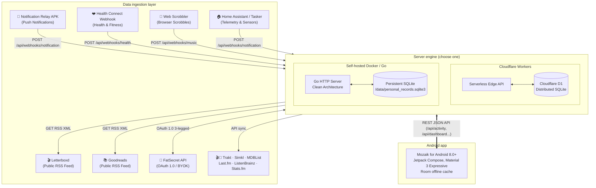

# 🏛️ Architecture & System Design

**Mozaik** is an open-source, self-hosted personal records and lifelogging hub. It decouples **data ingestion and storage** from **client-side consumption**, ensuring battery efficiency, privacy, and full data ownership.

---

## 1. High-Level System Architecture

---

## 2. Ingestion Plugin Architecture

The server acts as a centralized personal records collector with three distinct plugin contracts:

### A. Webhook Plugins (Push)
- **Concept:** External daemons, relay apps, or automation triggers push real-time events to the hub over HTTP POST.
- **Contract:** Accepts JSON payloads at `/api/webhooks/*` (single item or batch array) with deterministic IDs (for example `notif_<hash>`, `hc_<type>_<hash>`) so that repeated deliveries are idempotent.
- **Implementations:**
  - **[Notification Relay Webhook](https://github.com/Enki013/notification-relay-webhook):** lightweight open-source Android listener that forwards device notifications to `/api/webhooks/notification`.
  - **[Health Connect Webhook](https://github.com/mcnaveen/health-connect-webhook):** sends steps, sleep, heart rate, workouts, weight and more to `/api/webhooks/health`.
  - **[Web Scrobbler](https://web-scrobbler.com/):** browser extension that sends played tracks to `/api/webhooks/music` (Worker only).
  - **Tasker / Home Assistant:** can send custom webhooks to the notification endpoint.

### B. RSS Plugins (Pull / Polling)
- **Concept:** Periodic cron workers or on-demand sync calls fetch XML feeds, parse elements, and execute smart upsert queries.
- **Contract:** Registered under `/api/sync/<service>` with settings saved in `*_sync_settings` tables.
- **Implementations:**
  - **Letterboxd Plugin:** Syncs diary dates, ratings, and rewatches. Auto-formats simple usernames (e.g. `username` -> `https://letterboxd.com/username/rss/`). Detects prior watches to prevent duplicate or phantom "rewatch" records.
  - **Goodreads Plugin:** Fetches shelves, ratings, and read dates.

### C. API Plugins (OAuth and token based)
- **Concept:** 3-legged authentication with external service providers where users Bring Your Own Key (BYOK).
- **Contract:** Direct token exchange endpoints (`/fatsecret/connect`, `/fatsecret/callback`) and credential management (`/api/settings/fatsecret`).
- **Implementations:**
  - **FatSecret BYOK:** Allows users to input their own `Consumer Key` and `Consumer Secret` via the mobile app, authenticate in their phone's browser, and sync nutrition logs.
  - **Trakt.tv:** film and TV episode watch history and ratings from a public profile.
  - **Simkl:** film, series and anime watch history with a Client ID and Access Token.
  - **MDBList:** multi-source ratings (IMDb, Rotten Tomatoes, Metacritic, Letterboxd, Trakt), cached for 14 days.
  - **Last.fm, ListenBrainz, Stats.fm:** music listening history (Worker only).
  - **Planned:** Spotify listening history, Steam library and achievements.

---

## 3. Server engine parity

Both engines share the same data model and most endpoints. Music features, plugin toggles and the SQL dump are only in the Cloudflare Worker so far.

| Endpoint | Purpose | Supported by |
| :--- | :--- | :--- |
| `GET /api/health` | Health & database connectivity check | Worker D1 & Go Docker |
| `GET /api/dashboard` | Aggregated counter metrics & sync statuses | Worker D1 & Go Docker |
| `GET /api/activity` | Unified chronological timeline feed | Worker D1 & Go Docker |
| `POST /api/webhooks/notification` | Ingestion endpoint for Notification Relay | Worker D1 & Go Docker |
| `GET /api/settings/letterboxd` | Retrieve Letterboxd sync configuration | Worker D1 & Go Docker |
| `POST /api/settings/letterboxd` | Save Letterboxd username / RSS URL | Worker D1 & Go Docker |
| `GET /api/settings/goodreads` | Retrieve Goodreads sync configuration | Worker D1 & Go Docker |
| `POST /api/settings/goodreads` | Save Goodreads RSS URL | Worker D1 & Go Docker |
| `GET/POST /api/settings/fatsecret` | Retrieve & store BYOK credentials | Worker D1 & Go Docker |
| `POST /api/webhooks/health` | Ingestion endpoint for Health Connect Webhook | Worker D1 & Go Docker |
| `GET /api/health-connect/records` | Health Connect records | Worker D1 & Go Docker |
| `GET /api/trakt/history`, `GET /api/simkl/history` | Film and series watch history | Worker D1 & Go Docker |
| `GET /api/media/ratings` | MDBList multi-source ratings | Worker D1 & Go Docker |
| `GET /api/export/all` | Export entire database as JSON | Worker D1 & Go Docker |
| `GET /api/export/db` | Download SQLite database binary | Worker D1 & Go Docker |
| `GET /api/export/sql` | SQL dump of every table | Worker D1 only |
| `GET /api/music`, `/api/music/stats`, `/api/music/sync-*` | Music history, stats and Last.fm / ListenBrainz / Stats.fm sync | Worker D1 only |
| `POST /api/webhooks/music` | Ingestion endpoint for Web Scrobbler | Worker D1 only |
| `GET/POST /api/settings/music`, `/api/settings/plugins` | Music settings and integration toggles | Worker D1 only |

---

## 4. Go Backend Clean Architecture

The self-hosted Go backend (`backend/cmd/personal-records`) follows Clean Architecture:

- `backend/internal/application/`: Business rules, activity timeline merging, and sync coordinators.
- `backend/internal/infrastructure/sqlite/`: SQLite schema migration, store connection, directory guarantee, and repositories.
- `backend/internal/integrations/fatsecret/`: OAuth 1.0a signing and HTTP client.
- `backend/internal/presentation/http/`: REST JSON API handlers and HTML views.
- `backend/internal/config/`: Environment variable parsing (`PORT`, `HOST`, `DB_PATH`, `APP_BASE_URL`).

---

## 5. Android Client Design

- **Role:** Strictly a central reader, inspector, and manager. It does **not** run an in-app persistent notification listener service, eliminating background battery drain.
- **UI:** Jetpack Compose with Material 3 Expressive: shared filter headers, customizable stat cards, segmented lists, category colors, dynamic color and adaptive layouts (navigation rail and list-detail panes on wide screens).
- **Languages:** English and Turkish, switchable in the app.
- **Offline First:** Room database caches activities, food entries, books, and films for offline browsing.
